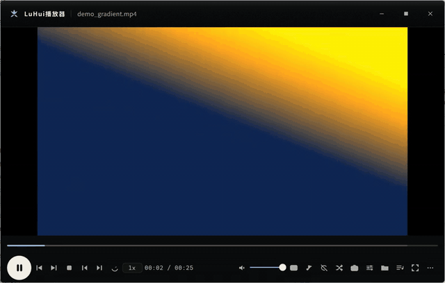
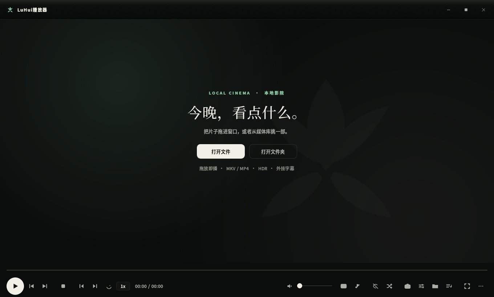

# LuHui Player (LuHui播放器)

[中文说明](README.md) · **English**

<p>


</p>

A local video player for Windows: **mpv does the decoding, a hand-drawn PyQt5 shell does the UI.**
No Electron, no web view, no network, no DRM, no telemetry.





## Why another player

- **The engine is mpv.** Decoding, hardware acceleration, colour management and rendering are mpv's job;
  the shell only handles interaction and visuals. No reimplementation of codecs, no broken HDR.
- **The UI is drawn, not skinned.** Frameless window, native DWM rounded corners and shadow, six sidebar
  pages, painted at physical pixels from 125% to 300% scaling (PerMonitorV2 manifest + fractional
  PassThrough; the embedded mpv child window is re-fitted on `WM_DPICHANGED`).
- **A timeline that shows the film.** Hovering shows real frame thumbnails with a time bubble; chapter
  markers, buffered range and A-B loop are visible.
- **Portable by construction.** onedir packaging: copy the folder, it runs. Config, cache, screenshots live
  inside that folder.

## Features

- Play/pause/stop, previous/next, frame step (`,` `.` or `Ctrl+←/→`), speed (`[` `]`, `\` back to 1x)
- A-B loop (`Shift+A` / `Shift+B` / `Shift+C`), playlist repeat and shuffle, resume per file
- Real frame thumbnails on the timeline, chapter marks, buffered range, time bubble
- Subtitles: embedded tracks, drag-and-drop external files, font/size/colour/outline/position,
  bilingual second track, 0.1 s delay steps (`J` / `Shift+J`)
- Picture page (`Ctrl+P`): aspect ratio, crop, rotate, panscan, pan, mirror, sharpen, denoise, deband —
  12 adjustments (6 geometry + 6 enhancement) applied as one filter-chain replacement
- Media library, single instance (a second double-click hands the file to the running window),
  crash log, mpv log, screenshot / GIF export

## Run from source

Needs Windows 10/11 x64 and Python 3.9+.

```bat
git clone https://github.com/gedouluhui/luhui-player.git
cd luhui-player
python -m pip install PyQt5

:: required, even when running from source:
::   runtime\mpv\mpv.exe            - the decoding core
::   runtime\mpv\mpv\fonts.conf     - subtitle font config (the packaging manifest checks it too)

:: optional, only for GIF export and timeline thumbnails:
::   runtime\ffmpeg\ffmpeg.exe

python -m app.main
```

Build a double-clickable folder (PyInstaller is a separate step):

```bat
python -m pip install pyinstaller
python -m PyInstaller packaging/portable.spec --noconfirm
```

`portable.spec` checks `runtime\` contents before packing and stops with `缺少打包资源：<path>` if something
is missing. Output: `dist\LuHui播放器\`.

External binaries are never trusted blindly: `packaging/runtime_checksums.sha256` pins the SHA-256 of
`mpv.exe`, `fonts.conf` and `ffmpeg.exe` (currently mpv v0.41.0-1101 / FFmpeg N-127213). The spec verifies
them before building and refuses on a mismatch; `python packaging/verify_runtime.py` runs the same check
standalone. When swapping the engine, update the manifest and the version line in both READMEs.

## CI gates

`.github/workflows/ci.yml` runs on `windows-latest`: `compileall` over the whole tree, a leak scan that
forbids personal absolute paths (`tests/ci_leak_scan.py`), and the full offline suite
(`tests/ci_offline.py` — 22 scripts / 361 checks, offscreen, isolated data dir, per-test timeout).
Scripts that need a real mpv/ffmpeg, local before-change baselines, generated launchers, psutil or
nvidia-smi (`test_usage.py`) stay local as probes; `pytest.ini` separates `unit` from `probe`.
The equalizer runs its no-kernel half in CI.

## Something is wrong? Run the doctor first

```bat
python -m app.doctor
```

It reports ~17 checks (interpreter, PyQt5 import, mpv present **and actually runs** `mpv --version`,
ffmpeg, writable data dir, disk space, config sanity, existing instance, crash log, mpv errors, shortcuts)
with "what it checked / what it saw / what to do next". No window, no pixels — works on a locked screen.
The count is whatever the report's own summary line says; don't trust the number in prose.

## Where files live

| Path | Contents |
|---|---|
| `data\config.json` | all settings (volume, keymap, paths, subtitle style, performance profile) |
| `data\logs\crash.log` | traceback of an uncaught exception — the only clue for "it just vanished" |
| `data\logs\mpv.log` | engine log |
| `data\cache\` | timeline thumbnails, library covers (LRU, auto-cleaned) |
| `data\library.json` | library index: scanned files and durations |
| `data\watch-state.json` | resume positions |
| `截图\` | still frames and GIFs |

Set `LUHUI_DATA` (legacy `GELU_DATA` still honoured) to move the data root.

## Known limits

- Windows only: rounded corners use the Win11 DWM API (Win10 falls back to square), native shadow needs Win10+.
- The repo does not ship mpv/ffmpeg binaries; put official builds under `runtime\` as shown above.
- "AI upscaling" profiles are deliberately absent: the bundled mpv build has no such options, and an
  unverified toggle is worse than none.
- No online sources, no DRM handling, no video editing/transcoding UI (ffmpeg is used for thumbnails and probing only).

## License

**GNU GPL v3.0** — see `LICENSE`; the UI layer uses GPL PyQt5. mpv, FFmpeg, Qt and Noto font licences are in
`THIRD_PARTY_NOTICES.md`.

## Feedback

Open an [issue](../../issues) with your Windows version, player version/commit, the file's container/codec
(visible in `mpv.log`), and reproduction steps. `data\logs\crash.log` is essential for "it closed itself" reports.

---

## More from the same author

- [LuHui Music Player](https://github.com/gedouluhui/luhui-music-player) — WinUI 3 shell + WASAPI exclusive-mode music player
- [Fanqie Alarm](https://github.com/gedouluhui/fanqie-alarm) — a Pomodoro timer that is one HTML file
- [pc-phone-proxy](https://github.com/gedouluhui/pc-phone-proxy) — auto-selecting proxy for Windows and Android
