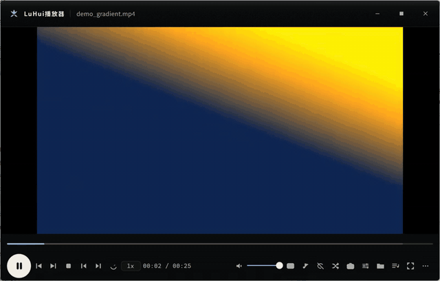
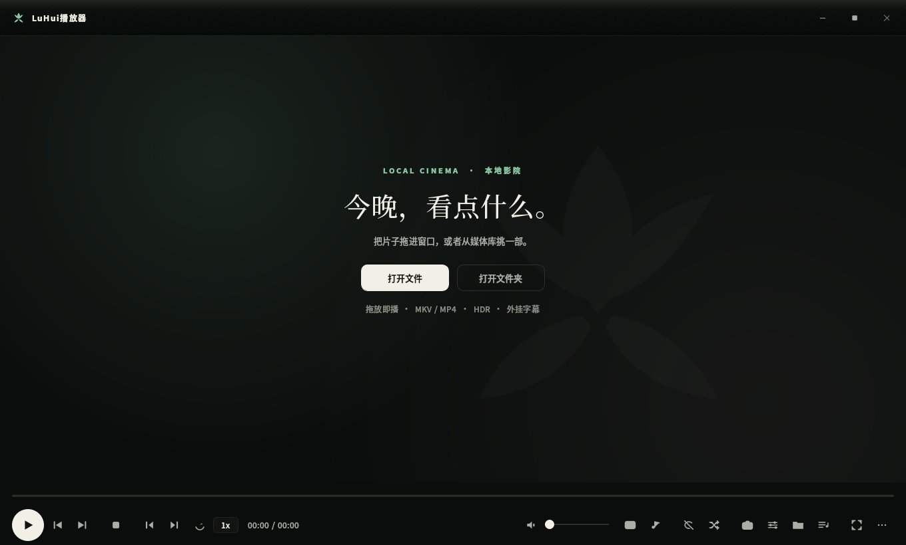

# LuHui播放器（LuHui Player）

**中文** · [English](README.en.md)

**Windows 本地视频播放器 —— mpv 解码内核 + PyQt5 自绘 Fluent 外壳。**

<p>


</p>

*A local video player for Windows: mpv does the decoding, a hand-drawn PyQt5 shell does the UI. No network, no DRM, no telemetry.*

无边框深色界面、DWM 原生圆角与阴影、硬解 / HDR / 常见容器与编码、外挂字幕、逐帧步进、A-B 循环、
真实画面缩略图、媒体库、断点续播。只播放本地文件：不联网、不抓取片源、不碰 DRM。





## 目录

[一、怎么启动](#一怎么启动) · [二、出问题了先跑这一条](#二出问题了先跑这一条) · [三、能做什么](#三能做什么) ·
[四、文件放在哪](#四文件放在哪) · [五、开发者：验收怎么跑](#五开发者验收怎么跑) · [六、明确不做](#六明确不做) · [七、许可](#七许可)

只想先用起来：下载/打包 → 看「一、怎么启动」；出问题 → 直接跳「二」那一条自检。

## 亮点

- **内核是 mpv**：解码、硬解、色彩管理与渲染都交给 mpv，外壳只负责交互与视觉。
- **自绘 Fluent 界面**：无边框窗口、原生贴边/阴影/圆角、六个侧栏页，125%–300% 缩放下按物理像素绘制
  （应用清单 PerMonitorV2 + 小数倍 PassThrough；跨屏拖动后按 `WM_DPICHANGED` 校准 mpv 原生子窗口）。
- **影厅级时间轴**：悬停出真实帧缩略图 + 时间气泡，章节标记、缓冲范围、A-B 循环可视化。
- **字幕与画面**：内嵌/外挂字幕、双语、延迟微调；12 项几何与画质调整（旋转、裁剪、镜像、锐化、降噪、去色带）。
- **单实例**：再次双击文件会转交给已开实例，不叠窗口。
- **便携**：onedir 打包，整个文件夹拷走即可运行；配置、缓存、截图都在文件夹内。

## 快速开始（源码）

```bat
git clone https://github.com/gedouluhui/luhui-player.git
cd luhui-player
python -m pip install PyQt5

:: 播放必需（缺一不可，源码运行也要有）：
::   runtime\mpv\mpv.exe            ← 解码内核
::   runtime\mpv\mpv\fonts.conf     ← 内核的字幕字体配置（打包清单同样硬检查这一份）

:: 只有 GIF 导出与时间轴缩略图才需要（不装照样能播）：
::   runtime\ffmpeg\ffmpeg.exe

python -m app.main
```

需要 Windows 10/11 64 位与 Python 3.9+（开发机 3.12.3）。打包成双击即用的文件夹
（打包器是单独的一步，源码运行不需要它）：

```bat
python -m pip install pyinstaller
python -m PyInstaller packaging/portable.spec --noconfirm
```

`portable.spec` 在开打之前会逐项检查 `runtime\` 里的 `mpv.exe`、`mpv\fonts.conf`、
`ffmpeg.exe`（以及仓库自带的 `packaging\assets\`），缺哪份就报 `缺少打包资源：<路径>`
并停下——**ffmpeg 在播放时可省，但便携包清单里是必需项**（工坊与缩略图要用它）。
产物在 `dist\LuHui播放器\`，双击 `LuHui播放器.exe` 即可。

---

## 一、怎么启动

四种走法，任选：

```bat
:: 1) 双击项目根目录里的「启动播放器.bat」（要带片子就在命令行里给它参数，见下）
启动播放器.bat D:\视频\某片.mkv

:: 2) 命令行启动（可一次带上文件和文件夹）
python -m app.main D:\视频\某片.mkv D:\视频\剧集文件夹

:: 3) 不带黑窗口的启动（桌面快捷方式用的就是这条）
pythonw -m app.main

:: 4) 桌面快捷方式：双击「LuHui播放器」，或把文件/文件夹直接拖到图标上
```

还有两条入口要靠注册表先到位，见下面两小节：**文件右键 →「打开方式」**（想让它出现在列表里就
导入 `注册到打开方式.reg`），以及**视频文件的右键菜单项**（导入 `右键用LuHui播放.reg`）。
两条都不导也能用——上面四种走法加"把文件拖进窗口"都照常工作。

那两个 `.bat` 与快捷方式一样，都是**生成出来**的（记录了你这台机器上的 Python 绝对路径）；
换了目录或换了 Python 就重跑一次生成脚本，两份都会原地更新：

```bat
python packaging\make_launchers.py        :: 启动播放器.bat + 故障自检.bat + 启动器 exe + 两套 .reg 模板
python packaging\make_launchers.py --check :: 只复查盘上那几份还跟当前路径一致，不写文件
```

快捷方式丢了或换了目录，重建一次（可重复跑，已存在就原地更新）：

```bat
python packaging\make_shortcut.py
```

**这个播放器是单实例的。**已经开着的时候再双击一个文件，不会开出第二个窗口，而是把那个文件
转交给正在运行的实例并把它带到前台。所以「双击没反应」通常是**已经有一个实例在别的地方**
（其他虚拟桌面、最小化、托盘），不是坏了——`python -m app.doctor` 会明确告诉你这一条。

### 想要右键菜单（可选，自己导入）

```bat
packaging\reg\右键用LuHui播放.reg   :: 双击导入：视频文件的右键菜单多一项
packaging\reg\撤销右键菜单.reg         :: 双击导入：把那一项撤掉
```

这两份文件**生成时不会被导入**——往注册表里写东西是不可逆的用户决定，所以那一半留给你自己点。
导入前可以先用记事本读一遍（它就是 UTF-16 文本）。范围只有一根键：

    HKEY_CURRENT_USER\Software\Classes\SystemFileAssociations\video\shell\LuHuiPlayer

也就是说：**只加一项右键菜单，不改任何扩展名的默认打开方式**（不碰 `HKLM`，也不碰 Win10/11
有哈希保护的 `UserChoice`）。想改默认打开方式请在 Windows「设置 → 应用 → 默认应用」里做。

### 想让「打开方式」列表里有它（可选，自己导入）

右键一个视频 → **打开方式** → 选「LuHui播放器」。要列表里出现这一项，导入这两份里的第一份：

```bat
packaging\reg\注册到打开方式.reg     :: 双击导入：48 种扩展名的「打开方式」里多一项「LuHui播放器」
packaging\reg\撤销打开方式注册.reg   :: 双击导入：只摘我们自己写进去的那几处
```

它写的是当前用户（`HKEY_CURRENT_USER`）下的四个位置，**都不碰默认打开方式**：

    Software\Classes\LuHuiPlayer.Media                （ProgID：显示名 + 那条 open 命令）
    Software\Classes\Applications\luhui-player.exe    （让它在列表里以"LuHui播放器"出现）
    Software\Classes\<每种扩展名>\OpenWithProgids    （只加我们自己那条值，别人的条目一字不动）
    Software\Microsoft\Windows\CurrentVersion\App Paths\luhui-player.exe

两个容易踩的点，模板里已经避开了：列表里那行字**不会是 ProgID 那串英文**——拿 `pythonw.exe` 当落点时
列表里出现的就是"pythonw"，用户既认不出也没法选，而且点了也不会播（pythonw 会把 `.mkv` 当脚本执行）。
所以落点是真启动器 `luhui-player.exe`，显示名「LuHui播放器」由两处一起供着：exe 的文件描述
`FileDescription` 与 `Applications\luhui-player.exe` 的 `FriendlyAppName`（本机没分离出到底哪一处供给的，
两处同值才是要紧的）；命令里取参数用 `%1` 而不是批处理写法 `%~1`。

生成这两份的脚本自己**永远不写注册表**，导入那一下是用户决定（本机已于 2026-10-16 按用户授权导入过，
要撤就双击上面那份撤销件）。导不导都随你，不导也不影响播放器本身。

导完怎么确认？注册表写没写到位、以及**外壳那份候选名单里有没有我们**，都可以不开窗口、不看屏幕地测：

```bat
python tests\check_openwith.py --check        :: 现数注册表：模板里 58 条值一条条对，另查默认程序没被动过
python tests\check_openwith_shell.py          :: 问 shell32 的枚举器：48 种扩展名的候选里有没有〈LuHui播放器〉
python tests\e2e_openwith.py                  :: 端到端：照注册表里那条命令原样起一次，看画面与时间推进
```

三条都是 `rc=0` 算过。它们都不是恒绿的：第一条带 16 条已知好坏对照（`--selftest`），第二、三条带
反向对照（`--expect-red`，故意喂个不可能的名字／坏路径，那本账必须翻红），第二条还另有一把尺子
`python tests\falsify_openwith_shell.py` 给它注入 4 处静默 bug 逐条要求翻红。细节与留档号见
`docs/design.md` §6 第 36 条。

两点如实说明：

- **列表里排第几、要不要再点一次「更多应用」，本机没法用程序看到**——资源管理器在这个版本
  （Win11 24H2）的窗口里，UIA 树只交出 1 个元素，文件列表和右键菜单都摸不到。所以上面第二、三条
  测的是**外壳那份候选名单本身**（`SHAssocEnumHandlers` 是它的官方入口；"菜单画的就是这一份"
  是合理推断，本机没能直接证明），不是截图里的菜单。
- 想让它成为**双击就播**的默认程序，请在弹出的打开方式面板里勾「始终」（或在
  「设置 → 应用 → 默认应用」里选）。这一步刻意不自动化：`UserChoice` 有哈希保护，硬写既不可靠
  也不该做，那一下本来就该由你点。不想翻菜单就直接跑这一条，它会打开那一页：

  ```bat
  start ms-settings:defaultapps
  ```

  设完不必猜——`python -m app.doctor` 的「默认程序现状」那一行会照实说"双击现在进的是谁"，
  归我们时它变 `[ OK ]`，归别人时它把那个 ProgID 一起印出来（别的播放器会去改写扩展名的类默认值，
  所以这一格是会被抢的；勾「始终」写的那格优先级更高，抢不掉）。

  **这台机器 2026-10-17 凌晨的那一次现数就是"被抢着"的形状**：`.mkv`/`.mp4` 的 `UserChoice` 一格都没有，
  而 `HKCU\Software\Classes\.mkv` 的类默认值是 `xmp.mkv`（迅雷影音），所以那时双击进的不是我们。
  这句话只是当时读数，现在归谁请以 `python -m app.doctor` 那一行为准；本轮修的是**文件进来之后**的那一半
  （不再出现"打开了播放器但片子没加载"），双击到底归谁不在那一格手里，得你自己勾「始终」。

### 双击之后到底播没播（这条链现在有留痕）

「打开了播放器、片子却没进来」是这条链上最难看的一类毛病，因为它有三个地方都能**静默**把文件吞掉：
注册表里那句命令不带参数位、启动器把参数交给外壳时外壳用 `os.path.exists` 一筛就丢（而 `pythonw`
没有控制台，那句警告永远没人看见）、已经开着实例时那句转交"写完字节就宣布成功"而接收方还在装配窗口。
现在这三处各有一条机器判据，而且**不静默**：

```bat
python tests\test_instance.py              :: 协议与四类参数形状（回执带 nonce、装配期排队、拿不到回执就自己开窗）
python tests\e2e_instance_handoff.py       :: 真起两个进程：已开着实例时再双击第二个文件
python tests\e2e_openwith.py               :: 照注册表里那条命令原样执行一次
```

每次外部打开都在 `data\logs\launch.log` 留一行（`kind=cold/forward｜argv 数｜kept｜dropped｜ignored`），
`python -m app.doctor` 的最后三项直接把这本账端出来——所以再遇到"双击没加载"，不用猜，看那行就知道
参数丢在哪一步。


---

## 二、出问题了先跑这一条

```bat
python -m app.doctor
```

不想敲命令就双击项目根目录的**「故障自检.bat」**——它就是上面那条，跑完停住给你看。

不开窗口、不看屏幕像素、锁屏也能跑。它一次报出 17 项，每项都写「查了什么、看到什么、下一步做什么」
（项数别信这句话，信报告最后那行自己数的「N 项阻断、M 项提醒、K 项正常」——三者之和就是项数）：

| 报的项 | 它在确认什么 |
|---|---|
| 解释器/平台 | Python 版本、是不是 Windows、项目根目录找不找得到 |
| PyQt5 | 界面库能不能 import（DLL 加载失败会单独点名） |
| 播放内核 mpv | exe 在不在，**并且真跑一次** `mpv --version` |
| ffmpeg | 在不在、跑不跑通（只影响 GIF 与时间轴缩略图，不影响播放） |
| 数据目录可写 | 真写一次再删掉——目录存在不等于能写 |
| 磁盘剩余 | 配置、缓存、截图所在卷还剩多少 |
| 配置文件 | 是不是合法 JSON、有没有会被兜成默认值的可疑键 |
| 已有实例（转交） | 命名管道上是不是已经挂着一个播放器 |
| 崩溃记录 | `crash.log` 有没有内容，有就把最后几行端出来 |
| 内核日志 | `mpv.log` 里有没有 error/fatal 行 |
| 桌面快捷方式 | 图标在不在、指向哪 |
| 键位表 | 生效键位条数、有没有按不响的写法、有没有互相遮挡 |
| 性能档位 | 当前 hwdec / gpu-api，以及「改完要重启才生效」的提示 |
| 资源占用实测 | psutil 在不在（内核/外壳那两行的来源）、nvidia-smi 找不找得到、**并且真跑一次**（GPU 那两行的来源）；没有 N 卡只算正常，不报提醒 |
| 外部打开链路 | 注册表里那条命令**能不能真的把文件送进来**：参数位缺不缺、指向的是不是当前这台机器上的那份解释器与脚本 |
| 默认程序现状 | 双击 `.mp4` 现在归谁（只报现状，**不替你改**——`UserChoice` 有哈希保护） |
| 上次外部打开的留痕 | `data\logs\launch.log` 最后一次收到几个参数、留下几个、丢掉几个——「双击没加载」这类问题就有现场了 |

三档结论：`[ OK ]` 正常 / `[WARN]` 提醒（不阻断，但有影响）/ `[FAIL]` 阻断。
有 FAIL 时退出码是 1，全绿是 0。

另外两条：

```bat
python -m app.doctor --keys      :: 打印当前**生效**的键位表（你改过就照这里查）
python -m app.doctor --falsify   :: 开发者用：喂已知坏数据，每条判据必须翻红
```

### 常见症状 → 先看哪一项

| 症状 | 最可能的原因 | 确认它 |
|---|---|---|
| 双击图标没反应 | 已有实例在跑，这次只是转交 | `app.doctor` 的「已有实例」 |
| **双击视频开了播放器但片子没进来**（界面停在『打开文件夹』那一页） | 注册表那句命令不带参数位、指着的不是这台机器上的启动器，或参数被静默吃掉 | `app.doctor` 的「外部打开链路」＋「上次外部打开的留痕」（那本 `launch.log` 逐次写着 `argv/kept/dropped/ignored`，参数到底丢在哪一步一眼可见） |
| 有声音没画面 | 硬解档位与本机驱动不合 | 设置页换个解码档，**重启播放器**（这四项是启动期参数，不会热切换） |
| 画面黑屏/花屏 | 同上，或 gpu-api 回退 | `data\logs\mpv.log` 里的 error 行 |
| 播到一半突然没了 | 未捕获异常导致进程 abort | `data\logs\crash.log`（这份日志就是为这一条存在的） |
| GIF 导不出、缩略图空白 | 没装 ffmpeg | `app.doctor` 的「ffmpeg」 |
| 某个键按了没反应 | 键位被改过或与其他键冲突 | `app.doctor --keys`，行尾会标「← 按不响」 |
| 「打开方式」列表里没有它 | 注册模板还没导入（生成器不代劳） | 双击 `packaging\reg\注册到打开方式.reg`，再 `python tests\check_openwith.py --check` 与 `python tests\check_openwith_shell.py` 现数 |
| 换了目录/拷到别的机器打不开 | 路径与快捷方式过期 | `python packaging\make_shortcut.py` 重建，再重跑 `python packaging\make_launchers.py`（模板里的绝对路径来自当前解释器） |

---

## 三、能做什么

**播放**：播放/暂停/停止、上一曲下一曲、逐帧步进（`,` `.` 或 `Ctrl+←/→`）、倍速（`[` `]`，`\` 回 1x）、
音量与静音、A-B 片段循环（`Shift+A` 起点 / `Shift+B` 终点 / `Shift+C` 清除）、
播放列表循环模式与乱序、**断点续播**（每个文件记住看到哪）。

**往列表里加东西有两种，差别看得见**：侧栏「播放列表」页里的「添加媒体文件／添加文件夹」＝**追加**——
列表变长、正在播的那一条接着播、它的下标不动；把文件**拖到窗口上**＝**整表替换**——换成拖进来的那几支、
从头播那第一条。列表本来空着时点「添加」会顺手把第一条播起来，不是只把条目放进列表就不动。
（2026-10-17 修过一次：追加在"刚换过片子"的那一刻会退化成整表替换，把你正在播那条挤没——
根因与判据见 `docs/design.md` §6 第 37(i)。）

**时间轴**：缓冲范围显示、章节标记点、鼠标悬停出**真实画面缩略图**+时间气泡（ffmpeg 抽帧，带缓存）。

**字幕**：内嵌轨切换、外挂字幕拖入即加载、字号/颜色/描边/位置自定义、双语字幕（sub2/ass 多轨）、
字幕延迟微调（`J` / `Shift+J`，0.1 秒一级）。

**画面**（侧栏第四页，`Ctrl+P`）：宽高比、按比例裁剪、旋转、保持比例／拉伸、充满画面（panscan）、
左右／上下平移、左右镜像、上下镜像、锐化、降噪、去色带——共 **12 个可调项**（6 项几何 + 6 档增强）。
几何走内核属性，增强走**整条滤镜链**：一次 `change-list vf set` 替换，不做逐档 append
（本机实测 append 一次只收一档，带逗号整条被拒；同档挂两次就在链上留两条，`remove` 也只删一条）。
快捷键 8 把：`R` 旋转、`Shift+R` 比例、`O` 裁剪、`P` 保持比例、`Shift+P` 充满画面、
`H`／`Shift+H` 左右／上下镜像、`Ctrl+G` 整族复位（几何＋增强一起回默认）。
硬解帧上滤镜能不能跑，界面不猜：链状态那一行同时看内核列表与内核日志里的 `Disabling filter` 原话，
列表挂着名字而像素一动不动的"假开启"会被红字点名。
亮度/对比度/灰度/饱和度/色相五个均衡滑条、HDR 色调映射、色域映射与目标峰值亮度在**调节页**（`Ctrl+T`）。
去色带有两处、不是同一个开关：这一页的是 **ffmpeg 滤镜 `deband`**（可热切，改完立刻看得见），
设置页性能档位里那档是 **mpv 自带的 GPU 侧去带**（启动期参数，实测热切不生效）；
高质量缩放（lanczos／mitchell）也在性能档位的预设里。
所有可调项的量程以内核回报的真值为准——本机实测内核面对越界值是**整条拒收**（停在发之前的旧值，
一次都没夹过），所以夹紧与取模都由外壳做，界面画的是回读结果，不是"我发出去的值"。

**声音**：音轨切换、音频设备切换、音频延迟微调、音量上限可选到 200%（默认）直至 300%。

**声音均衡**（侧栏第五页）：31 Hz–16 kHz **十段**每段 −12…+12 dB，另有前置增益 −18…+6 dB，
六条预设（平坦／人声／低音／明亮／影院／夜间）。三条写在界面上的实测结论：
①**归零＝整条不挂滤镜**（内核读回空列表，声音就是原片，面板不会写着"0 dB"却偷偷挂十一条）；
②**热切真能听见**——播到中段挂上去，低频带从 48.4 dB 到 59.2 dB（本机实测，`tests/out/eq-probe-r15b.log`），
所以拖动松手就下发，不需要"重开片子才生效"；
③**抬太高会削顶**：十段全 +12 不带前置时产物 `clip=657`，同一串后面加 `volume=-9dB` 变 `clip=0`——
所以预设自带负前置，而用户自己拖的前置只在状态行提醒"净抬升"、不替他改。
量程是外壳收窄的（内核自己允许 −900…+900 dB）：本机实测越界值的下场是**整条 af 起不来、一声不出**
（内核原话 `Audio filter initialized failed!`），所以界面上出现不了 999。
内核没起来时**照样能调**——这些值会记进设置并在播放时一次带上，状态行写"已记入设置，播放后生效"。

**性能**：解码档位（auto-safe / d3d11va / nvdec / …）、GPU API、缩放预设都在设置页；
`I` 键打开统计页，实时看解码通路、丢帧计数、音画偏差、缓存时长——**内核没回报的字段整行不画**，不写 0 糊弄。
下半页另有**资源占用**：点「采样 3 秒」量内核/外壳各自的 CPU 与内存（psutil 按进程），顺带取一次 GPU 利用率、
显存、温度、功耗、SM 时钟与限流原因（nvidia-smi，**整机**读数，报表里就写着"不是本播放器独占"）；
量不到的项写"没测到"加原因，"复制报表"能把整段纯文本粘出去问人。采样在线程池里跑，界面这三秒不卡。

**GPU 加速**（本机默认档就是这样跑的，数字来自 `python tests\e2e_gpu.py`，留档 `tests\out\e2e-gpu-1017-024833.log`）：
硬解不是"设置里写着"而是内核自己回报的——`hwdec-current='d3d11va'`、`current-gpu-context='d3d11'`、
`current-vo='gpu'`；同一趟里强制软解做对照，NVDEC 占用从峰值 **18.0** 掉到 **0.0**、内核 CPU 从
**10.9%** 涨到 **195.1%**（这两码就是"硬解确实在跑"的那对牙，否则那条绿是恒真废尺）。
三支 4K60（HEVC／H.264／AV1）的进度推进率 **1.001／1.003／1.000**（≥0.90 判实时），画面掉帧增量 **0**。
"跑在哪块卡上"也有实测答案：内核日志里的适配器名与 `nvidia-smi` 首卡同名
（`NVIDIA GeForce RTX 3070 Ti Laptop GPU`）。缩放预设那三档（fast／balanced／high）本来就算在显卡上
（`vo=gpu` 下的 `lanczos`／`mitchell`／`ewa_lanczossharp` 一族）。
**没有做的档位**：迅雷影音那类"AI 超分"——这台机器自带的内核构建里根本没有神经超分那组选项
（`--list-options` 1274 行里 `--ngu-*`／`ancedx4` 零命中），要做得换内核构建或外挂 shader，见「六、明确不做」。

**截图工坊**：`E` 存当前帧（右键菜单另有「截图（含字幕）/ 截图（仅画面）」两档）；`G` 打开工坊窗口做
**GIF 片段导出**（宽度/帧率/时长/是否烧字幕——字幕只烧**外挂字幕文件**，内嵌轨要先解成文件才行）；
`B` 连拍（张数与间隔）。导出走 ffmpeg 且带进度；**关掉窗口就是取消这一趟导出**，不会在后台偷偷写盘。
工坊是不模态的面板，开着它的时候播放快捷键**照样能按**（空格暂停、`B` 连拍、`←→`  seek 都不用先点一下
播放器）——键位表会镜像到工坊身上，`Esc`/`Enter` 这三把留给面板自己用。

**媒体库**：添加文件夹后扫描，显示封面、时长、看过的位置（续播进度逐条取）。排序里有
「最近加入」，那是**文件的修改时间**，不是"最近播放"列表——**「最近播放」这一页本机没做**：
播放过的路径一直在往配置里的 `recent` 存（还会按规范化路径去重），但界面现在没有任何一处读它
（普查留档 `tests\out\recent-consumers-1017-0322.txt`：`app\ui\` 里读 `recent` 的 0 行），
所以别把它当成已有功能（`docs\design.md` §6 第 37(d) 记了这条实测与那句说错了的话）。
库大到几百上千项时窗口照常回话：搜索框打字不在途中重扫整库（合并输入后再画），封面先铺占位块、
再一张一片地补上（不在重建那一趟里逐张解码），往里拖一个文件夹也不会把播放列表反复清造。

**界面**：无边框窗口（保留原生阴影、圆角、贴边快照）、侧栏六页（播放列表/媒体库/调节/画面/声音均衡/统计）、
全屏、浮动控制条与 OSD 气泡、主题色可选（设置页改完立即生效）。

**快捷键**：`F1` 看一览，`Ctrl+K` 打开编辑页——改键、删键、加键、恢复默认、导出/导入成 JSON。
默认 72 条（`app/ui/keymap.py` 的出厂表，改过的以 `python -m app.doctor --keys` 的输出为准）。

**其他**：睡眠定时器（`Ctrl+S`：到点可选**暂停播放 / 停止播放 / 退出播放器**，倒计时按剩余时刻现算，
随时可取消）、设置页（`Ctrl+,`：解码档位与路径/主题/续播，每项标了生效时机——立即 / 下次载入 / 重启）。

---

## 四、文件放在哪

| 位置 | 内容 |
|---|---|
| `data\config.json` | 全部设置（音量、键位、路径、字幕样式、性能档位……） |
| `data\logs\crash.log` | 未捕获异常的落盘栈（排查「突然没了」的唯一线索） |
| `data\logs\mpv.log` | 内核日志 |
| `data\cache\` | 时间轴缩略图、媒体库封面（带 LRU，会自动清） |
| `data\library.json` | 媒体库索引：扫过的文件与时长，只在"变了/没见过"时才重新探测 |
| `data\watch-state.json` | 每个文件看到哪（断点续播就靠它） |
| `截图\` | 存帧与 GIF/连拍的产物（设置页可改到别处） |

想把用户数据挪走，设环境变量 `LUHUI_DATA`（旧名 `GELU_DATA` 仍然认）指向别的目录即可（配置、缓存、日志都跟着走）。
配置读坏了不会开不起来：它会被自愈成默认值，同时你的自定义会丢——所以改设置前先备份这个文件。

### 内核放在哪

```
runtime\mpv\mpv.exe            ← 必需，缺它完全放不了片
runtime\mpv\mpv\fonts.conf     ← 必需，内核渲染字幕时的 Fontconfig 配置
                                 （就是 Fontconfig 的标准模板，占位符 WINDOWSFONTDIR /
                                 WINDOWSUSERFONTDIR 原样别改；打包清单硬检查这一份）
runtime\ffmpeg\ffmpeg.exe      ← 可选，只影响 GIF 导出与时间轴缩略图
                                 （打包成便携版时必需：portable.spec 会检查它）
```

本项目当前用的是 mpv v0.41.0-1101 与 FFmpeg N-127213（官方 CI 构建，sha256 对过 release 清单）。
`python -m app.doctor` 会直接告诉你它们在不在、跑不跑得通。

源码仓库不提交这些运行时文件（`.gitignore` 把整个 `runtime\` 排除在外），自行准备放入即可：
mpv 见 https://mpv.io/installation/ ，FFmpeg 见 https://ffmpeg.org/download.html 。
`fonts.conf` 用 Fontconfig for Windows 自带的那份标准模板，原样放进 `runtime\mpv\mpv\`。

**外部二进制零盲信**：`packaging\runtime_checksums.sha256` 固定了上面三份文件的 SHA-256
（当前对应 mpv v0.41.0-1101 / FFmpeg N-127213）。`portable.spec` 开打前先核对，
对不上就停下；换内核必须同步更新清单与这里/README.en 的版本行。单独核对：

```bat
python packaging\verify_runtime.py
```

---

### 自动化门禁

`.github/workflows/ci.yml` 在 `windows-latest` 上跑三件事：

1. `python -m compileall -q app packaging tests`——全树编译检查；
2. `python tests\ci_leak_scan.py`——发布前防泄漏，个人绝对路径一处都不许进仓库；
3. `python tests\ci_offline.py`——离线回归全套（22 份脚本、359 条判据，强制 offscreen、每份独立数据目录与限时）。

需要真实 mpv、真 ffmpeg、本地改前留底或生成产物的脚本（`test_engine.py`、`test_ui.py`、`test_thumbs.py`、
`test_library.py`、`test_instance.py`、`test_usage.py` 等）**不在 CI 里假装跑过**，留在本地按需执行；
`pytest.ini` 用 `unit` / `probe` 标记区分两类。均衡器在 CI 里自动带 `--no-kernel`，只跑不依赖内核的那一半。
`test_usage.py` 要 psutil 与 nvidia-smi，runner 没有 GPU，它的环境门禁会退 2，因此已归入本地探针。

---

## 五、开发者：验收怎么跑

```bat
python tests\gen_sample.py                 :: 合成样片：H.264+AAC 视频 + 同名外挂中文字幕，不依赖网络素材
python tests\test_engine.py                :: 内核层（IPC/属性订阅/seek/倍速/音轨/截图/内核崩溃重启）
python tests\test_ui.py                    :: 外壳（真窗口、真内核、真截屏）；台账条数与判废数只看它自己打的汇总行
python tests\test_append_semantics.py      :: 播放列表追加语义＋换文件时的订阅缓存表（离线，真内核真 mpv）
                                             ::   判据表与变异表的条数由脚本 [FINAL] 自打，这里不抄；
                                             ::   它钉的是"哪些属性格不许被 start-file 抹掉"——机制见 docs\design.md §6 第 37(i)
python tests\test_open_receipt.py          :: 「已载入／已追加」那句话的离线判据＋已知读数逐档喂＋坏写法证伪
                                             ::   判据表／读数档数／变异表条数都由脚本 [FINAL] 自打，这里不抄；
                                             ::   判的是：这句话**只许**由内核推来的证据撑着（file-loaded／playlist 增长／
                                             ::   超时分流），不许由"我们把命令写掉了"撑着——2026-10-19 双击黑屏那笔账
                                             ::   里，内核把整条 loadfile 退了回去，屏幕上却写着"已载入 1 个文件"
                                             ::   同一份的 --falsify：把那句谎注回去必须当场顶红
python tests\e2e_loadfile_receipt.py       :: 真内核那一腿（唯一问过内核的一腿）：产品的 open_files 真起 mpv 真播
                                             ::   读的是内核自己的 time-pos／duration／file-loaded，不读订阅缓存；
                                             ::   ①没历史 ⇒ 时间轴贴 0 ②有历史 ⇒ 必须从历史位置起 ③两趟读数必须拉开
                                             ::   ④产品路上零退回 ⑤内核的拒绝原话在 data\logs\mpv.log 里看得见
                                             ::   样片是 gelu-sample-long.mp4（32s，gen_sample 的样片 D）：短片上
                                             ::   「片尾 15 秒算看完」那条规则会把任何进度判成 0，续播档没有合法输入
                                             ::   这趟的牙＝注入当年凶形状，留档 tests\out\e2e-loadfile-drift-1019-215401.txt
python tests\test_transform.py             :: 画面变换与增强：离线表 + 真机两路像素（video / 固定窗口 window）
                                             :: 同一份的 --falsify 喂坏样本并当场摘产品承重件
python tests\capture_sweep.py                :: 逐屏留档：每张界面一份 PNG＋五把机械尺（有墨/截字/裁了没留线索/叠字/掉出视口）＋跨主题对比表
                                               :: 不抓屏那半不需要屏幕亮着，但**必须在产品装配的平台上跑**：
                                               ::   别套 QT_QPA_PLATFORM=offscreen——墨迹下限是按 Windows+150% 缩放的
                                               ::   像素标的，离屏会把同一片文字读到约 1/7，这份量具现在直接拒跑退 2
                                               :: `--screen` 那半不给像素就退 3
                                               :: 同一份的 --falsify：52 条已知坏样本必须逐条翻红（含压扁尺五条、掉出视口尺六条、
                                               ::   以及抓屏前提那两条「什么都不收拾」的对照）
python tests\test_thumbs.py                :: 时间轴缩略图链
python tests\test_library.py               :: 媒体库扫描/索引/封面＋`recent` 那张表按规范化路径去重（数据层，界面上还没有这一页）
                                             ::   （同一部片的 `F:/x.mp4` 与 `F:\x.mp4`、大小写不同，都不许并排占两格；
                                             ::   只给列表去重做键，**不动 watch-state 的键**——否则用户存下的进度读不到）
                                             :: 同一份的 --falsify：静默给错数与去重键退化必须被点名
python tests\test_instance.py              :: 外部打开那一族的协议与参数形状（30 条判据；--falsify 13 种坏写法必须各自顶红）
                                             ::   判的是：转交回执带 nonce、装配期先排队 attach 后补交、拿不到回执就自己开窗、
                                             ::   四类参数形状（多套一层引号／没展开的 %1 与 %~1／被空格劈开的同一路径／相对路径）
python tests\e2e_instance_handoff.py       :: 真起两个进程踩那条只有真两进程才碰得到的路：已开着实例时再双击第二个文件
                                             ::   断言窗口标题、mpv 子进程、path、playlist-count、时间推进与 launch.log 那两行
                                             ::   --expect-red 是反向对照（故意喂盘上没有的路径，那本账必须翻红）
                                             ::   静音是从**被测实例自己的内核**读回的，用户真目录四样指纹开跑前后逐字相同
python tests\e2e_gpu.py                    :: GPU 实测（三档装配串行：默认硬解／强制软解／非法值回退）
                                             ::   读的是内核回报的 hwdec-current，不是配置里那个愿望；
                                             ::   --expect-red 要求"软解那趟报硬解在跑"必须翻红——①那条绿的牙就在这儿
python tests\test_responsiveness.py        :: 界面响应性：只数次数不掐表（13 条判据 + 15 条"拆回原样"注入）
                                             :: 同一份的 --falsify：打字把整库重扫几遍、拖文件夹把列表清造几遍、
                                             ::   一张新缓存回来把全目录扫几遍、逐条问进度真读盘几次——四笔账
                                             ::   的坏写法必须逐条翻红。offscreen 起跑，不起内核、不起 ffmpeg、
                                             ::   不抓屏，屏幕睡着也能跑
python tests\test_equalizer.py             :: 声音均衡器（表 33／引擎 10／面板 30 离线，真机 14 条要内核与有声轨的样片）
                                             :: 同一份的 --falsify：注入 22 处坏写法（三家离线判据各摘一件承重件）必须逐条翻红
                                             :: 不起内核那半用 --no-kernel 跑，真机半记 ENV 判废（退 3），不写产品失败
python tests\test_keymap.py                :: 键位事实表（生效表、死写法、撞车）
python tests\test_keymap_dialog.py         :: 改键对话框
python tests\test_gif.py                   :: GIF 参数与命令拼装（不启进程）
python tests\test_gif_dialog.py            :: 工坊对话框
python tests\test_gif_wiring.py            :: 主窗口接线
python tests\test_gif_real.py              :: 截图工坊真机验收（要屏幕亮着）
python tests\smoke_launch.py               :: 按真实启动路径端到端（python/pythonw/.lnk）
python tests\check_lnk.py                  :: 点桌面快捷方式那条链路
python tests\audit_qt_attrs.py --selftest  :: 静态扫 Qt 成员写法在本机 PyQt5 上存不存在（已知答案对照 14 条，2026-10-12 数 `[PASS]` 行现得；含"审计器自己别把没导当成没有"）
python tests\probe_surface_cover.py        :: 给侧栏加一页时跑它：逐屏体检那四处手抄名单（SURFACES／捕法／下标／widget_of）齐不齐；--falsify 7 处注入必须逐条点名。不建窗口、不写文件，屏幕睡着也跑。2026-10-13 起它同时被 `test_ui.py` 结构段那条对账腿调用（`PSC.load()`→`PSC.judges()`），所以不必再"记得单独跑才算数"；判据条数有下限，空表不许冒充全绿
python packaging\make_launchers.py --selftest :: 启动脚本/启动器/两套 .reg 模板的 68 条已知好坏对照（2026-10-16 现数收尾行）
python tests\test_launchers.py             :: 那七份文本产物加启动器真跑一遍（cmd 读 .bat、陌生 cwd 跑 open_file.py）；--falsify 把盘上产物改坏 18 条（同日发布数，CAUGHT 18／MISSED 0／NOP 0）
python tests\check_openwith.py --check     :: 只读，现数注册表：模板里 58 条值逐条对＋默认程序（UserChoice 与扩展名默认值）没被动过；--selftest 16 条已知好坏对照
python tests\check_openwith_shell.py       :: 问外壳自己的数据源 shell32!SHAssocEnumHandlers：48 种扩展名的候选名单里有没有〈LuHui播放器〉；--expect-red 是反向对照，本机这条判据的鉴别力口径见 §6 第 36 条
python tests\falsify_openwith_shell.py     :: 给上面那条量具注入 4 处静默 bug，逐条要求当场翻红并点名
python tests\e2e_openwith.py               :: 端到端：照注册表里那条命令原样起一次，断言窗口标题、mpv 子进程、path、时间推进与像素
python tests\test_usage.py                 :: 资源占用实测链（psutil 按 pid + nvidia-smi 整机）；--falsify 把实现改坏 9 条
```

日常回归不必逐条敲，有一条常跑链一把跑全：

```bat
python tests\chain_r17.py                  :: 串行跑 26 趟，全程持锁（tests\out\chain-r17.lock）——
                                             ::   会抢前台的 UI 看门狗见锁就不起趟，两条链不会打架；
                                             ::   锁被占着时它**拒跑**（退 3）而不是排队，因为"会改文件的趟一次只一趟"；
                                             ::   收尾把每一趟的 rc 与 [FINAL] 写进 tests\out\chain-r17-done.flag，
                                             ::   绿/真失败/环境不给/本轮不作数 四个数和趟数都由脚本自己数（这里不抄）
```

最近这轮（R19，2026-10-19 改完「双击开片黑屏」那笔账之后）的哨兵原文
（`tests\out\chain-r19-done.keep-1019-220225.flag`，`generated_at=2026-10-19 22:02:25`，
`.keep-` 那份是**不可被下次运行覆写**的留底）：`绿 26／真失败 0／环境不给 0／本轮不作数 0 —— 趟数由脚本自己数，共 26 趟`。
往前三趟只记历史，不带趟数尾巴（带尾巴的那一串一律比最新哨兵）：10-17 02:50 那趟是
`绿 22／真失败 0／环境不给 1／本轮不作数 0`，唯一那格 `rc=2` 是
`端到端：按注册表里那条命令原样执行（正跑）` 的**像素腿**（整屏 3840×2160 亮度 0，机器锁着屏），
功能腿照常 PASS——按口径记环境不记产品；同一轮 09:42～09:50 引擎缓存表动过之后复跑
`绿 23／真失败 0／环境不给 0／本轮不作数 0`，那次空着的像素腿这回屏亮着，真跑了
（`端到端：全绿 —— PASS 16／FAIL 0／ENV 0`），R19 这趟那条像素腿照旧全绿。
哨兵只逐趟点名 rc，判据条数在同一轮那本日志里
（`tests\out\chain-r19.keep-1019-220225.log`，前两趟分别是 `chain-r17.keep-1017-025027.log`
与 `chain-r18.keep-1017-095043.log`）：
实例层正跑 30 条判据／证伪 13 条坏写法（CAUGHT 13／MISSED 0／NOP 0）、
GPU 实测 PASS 21／FAIL 0／ENV 0（三档装配串行，反向对照那趟真的翻了红）、「已开实例再双击」PASS 16／FAIL 0
与它的反向对照、启动器验收「共 76 项，失败 0 项」（这条数行判据自己带 7 格已知答案对照：它以前只数
`[ OK ]`，把本机那两条 `[WARN]` 读成"报告缺两行"，于是把没坏的产品报成真失败）。
本轮新进去的两条腿：`打开回执`（离线判"界面那句话只许由内核证据撑着"）与
`端到端：真内核 loadfile 回执`（真起 mpv 问内核收不收、收了有没有从续播位置起）——
它们各自的条数由脚本 `[FINAL]` 自打，这里不抄。

判据口径四条，脚本都照着写：

1. **证伪模式**：`--falsify`（审计脚本叫 `--selftest`，关窗残留叫 `--residue`，doctor 的整链负对照叫 `--neg`）。
   喂进去的已知坏样本必须**逐条翻红**，好样本必须绿——判据不许恒真。
2. **环境不满足要单独报码**：缺 mpv/ffmpeg/样片退 2，屏幕抠不出像素、或工具窗此刻做不成活动窗
   （判据的前提立不住）退 3，都不许写成产品失败。
   `test_usage.py` 同口径——没装 psutil 或找不到 nvidia-smi 都退 2（那份验收要靠它们证明"真量到了"）。
3. **卡住要留下栈**：`test_engine.py`、`test_ui.py`、`test_gif_real.py` 这三条真机链统一开
   `faulthandler.dump_traceback_later`，一轮跑不完会在日志里留当时卡在哪一行。
4. **卡顿要数次数，不许掐表**：`test_responsiveness.py` 量的是"同一件事被做了几遍"——一次击键把整库
   重扫几遍、拖一个文件夹把播放列表清造几遍、一张新缓存回来把全目录扫几遍、逐条问进度真读盘几次。
   耗时不进契约（同一份改动在别的机器上能差三倍：杀软、磁盘冷热、封面缓存新鲜度都在里面），次数进。
   每条判据都得能被"拆回原样"注入打红，而且**注入真打红了才算数**——首轮就有一条"看着抓到、其实是空操作"的
   漏网（场景里那 6 项无论怎么排都还在表内），详见 `docs\design.md` §6 第 32 条。

像素类验收（`test_ui.py`、`test_gif_real.py`、`test_transform.py` 的真机半、`smoke_launch.py`、
`capture_sweep.py --screen`）需要屏幕亮着且窗口不被遮挡；
不看像素的（`--residue`、`app.doctor`、`test_engine.py` 与 `test_transform.py` 的离线半）随时能跑。
被**别人进程的窗口**压住时不算产品失败：抓屏闸门按 pid 分流，那种红记 `[ENV]`、整轮收 3
（挡住眼睛 ≠ 我们没画出来，两本账分开记，见 `docs\design.md` §6 第 31 条）。
显示器休眠/锁屏时不必守着，三条链路各有一条看门狗会等屏幕给像素、条件一翻转就把尾巴跑完：
`python tests\watch_gif_real.py`（工坊真机三档，产物落 `tests\out\FINAL-gif-real-<时间戳>.md`）、
`python tests\watch_ui_round.py`（R7 五趟：外壳证伪 → 外壳验收 → 逐屏抓档标准档 → 1.3 档 → 1.8 档，
各自的退出码写进 `tests\out\ui-round-done.flag`；某一趟开跑前屏幕又暗了就**接着等**，
等到 8 小时上限才记"跳过"，不判产品坏。1.3/1.8 两档是给"侧栏需求量算少了一根滚动条"
那处修复补的出厂装配实测口径，见 `docs\design.md` §6 第 30 条）、
`python tests\watch_cover_experiment.py`（R9：从**另一个进程**压一扇置顶窗，再看验收那八处像素判据
是不是真的记 `[ENV]`、汇总"无失败"、rc=3——`--falsify` 里的 U57 是接线桩，证不了真窗口那一半；
结论逐趟写进 `tests\out\cover-exp-done.flag`，屏中途又暗就换下一趟，最多 12 趟）。
都自带 8 小时上限，超时也留"跑到哪一步"的说明，绝不静默消失。

---

## 六、明确不做

不装全局鼠标/键盘钩子；**生成器自己不写注册表**——右键菜单与「打开方式」都只生成 `.reg` 模板，
导入那一下是用户决定（本机只有「打开方式」那套在 2026-10-16 经你明确授权由助手 `reg import` 过一次；
右键菜单那套至今没导入，`tests\test_launchers.py` 的 NOTE 行会照实报"HKCU 查不到"；两份撤销件同在
`packaging\reg\`）；
不碰任何扩展名的**默认打开方式**（`UserChoice` 有哈希保护，硬写既不可靠也不该做，
要设默认请用系统「设置 → 应用 → 默认应用」自己指过来）；不改 hosts；
不做在线片源抓取、不碰 DRM 内容；不做视频编辑/转码界面（ffmpeg 只用于缩略图与探测）；
**不做"AI 超分"档位**（迅雷影音那类开关）：不是"内核不支持这个功能名"，而是**这台机器自带的那版内核
里没有那组选项**（`--list-options` 共 1274 行，`--ngu-*` 与 `ancedx4` 零命中，整包原始输出留在
`tests\out\mpv-list-options-1017-0306.txt`；`--scale`/`--cscale`
里的 `ewa_lanczossharp`／`lanczos`／`jinc` 这些**已经在跑的 GPU 侧高质量缩放**是另一回事，设置在
性能档位里）。真要做只能换内核构建或外挂第三方 shader，而两者好不好用得看**掉帧**，掉帧必须让窗口
真出帧才量得到——现成的量具就是 `tests\e2e_gpu.py` 那把推进率＋掉帧增量尺，量完再决定，
不给你一个没人验证过的档位；不做"录制"按钮（本机实测四条硬伤，见 `docs\design.md` §7）；
不追求 Windows 7 兼容（窗口圆角走 Win11 的 DWM 接口，Win10 上自动退回直角；原生窗口阴影需要 Win10 及以上）。

---

## 七、许可

本项目以 **GNU GPL v3.0** 发布，全文见 `LICENSE`。之所以是 GPLv3：界面层使用 GPL 版本的 PyQt5。
mpv、FFmpeg、Qt、Noto 字体的许可见 `THIRD_PARTY_NOTICES.md`。

## 八、反馈

提 [Issue](../../issues) 时请附：Windows 版本、播放器版本（或 commit）、片子的容器/编码
（`mpv.log` 里能看到）、复现步骤。能附 `data\logs\crash.log` 最好——"突然没了"这类问题没有它就查不动。

---

## 同作者的其他项目

- [LuHui音乐播放器](https://github.com/gedouluhui/luhui-music-player) —— WinUI 3 + WASAPI 独占的本地音乐播放器
- [番茄闹钟](https://github.com/gedouluhui/fanqie-alarm) —— 整个应用就是一个 HTML 的番茄钟
- [pc-phone-proxy](https://github.com/gedouluhui/pc-phone-proxy) —— 电脑 + 安卓双端自动选线代理
